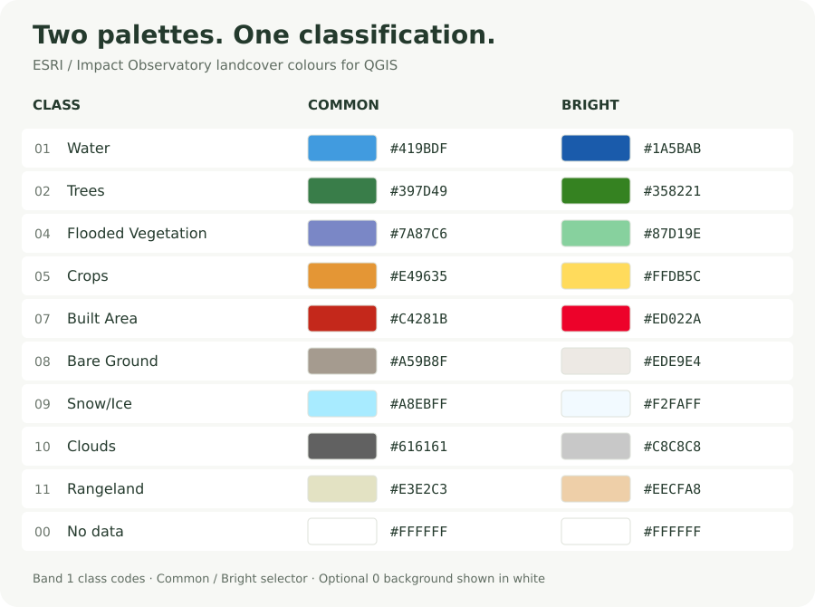

<p align="center">
  <a href="https://qgis.org/"></a>
</p>

<h1 align="center">ESRI / Impact Observatory<br>Landcover Colours &amp; Assets</h1>

<p align="center">Two familiar palettes. Clear class labels. Ready for your next QGIS map.</p>

<p align="center">
  <a href="https://qgis.org/"></a>
  
  
  
</p>

A QGIS Processing script and two ready-to-load raster styles for the **ESRI / Impact Observatory nine-class landcover classification**. Choose the **Common** palette or the more vivid **Bright** palette without changing your raster data.

The colorizer scans **band 1** and builds a legend using only supported class values found in the raster. Its right-hand help panel includes a side-by-side colour reference with hex codes.

## 🎨 Compare the palettes



| Value | Landcover class | Common | Bright |
| --- | --- | --- | --- |
| 1 | Water | `#419BDF` | `#1A5BAB` |
| 2 | Trees | `#397D49` | `#358221` |
| 4 | Flooded Vegetation | `#7A87C6` | `#87D19E` |
| 5 | Crops | `#E49635` | `#FFDB5C` |
| 7 | Built Area | `#C4281B` | `#ED022A` |
| 8 | Bare Ground | `#A59B8F` | `#EDE9E4` |
| 9 | Snow/Ice | `#A8EBFF` | `#F2FAFF` |
| 10 | Clouds | `#616161` | `#C8C8C8` |
| 11 | Rangeland | `#E3E2C3` | `#EECFA8` |
| 0 | No data / background | `#FFFFFF` | `#FFFFFF` |

**Common** uses orange crops, lavender flooded vegetation, and a muted red for built areas. **Bright** uses yellow crops, mint flooded vegetation, and vivid red built areas. Bright is the script's default.

## 📦 Files and downloads

| File | Purpose |
| --- | --- |
| [esri_landcover_colorizer.py](scripts/esri_landcover_colorizer.py) | Processing tool with a Common / Bright selector and colour help panel. |
| [ESRI_10m_Common.qml](styles/ESRI_10m_Common.qml) | Full Common palette for direct loading in QGIS. |
| [ESRI_10m_Bright.qml](styles/ESRI_10m_Bright.qml) | Full Bright palette for direct loading in QGIS. |

**[Download the complete repository as ZIP](https://github.com/Heed725/ESRI---Impact-Observatory-Landcover-Colors---Assets/archive/refs/heads/main.zip)**, or open an individual file above and use GitHub's **Download raw file** button.

This repository contains styles and code; download your landcover raster separately.

## 🚀 Install the Processing script

Requires **QGIS 3.x** with the Python Processing framework enabled. The script uses QGIS's bundled Python and Qt bindings; no extra Python packages are required.

1. Download and extract the repository ZIP.
2. Open QGIS and load your ESRI / Impact Observatory classification raster.
3. Open **Processing → Toolbox**.
4. Open the toolbox's **Scripts** menu and choose **Add Script to Toolbox…**.
5. Select `scripts/esri_landcover_colorizer.py`.
6. Find **ESRI Landcover Colorizer** under **Scripts → Raster Analysis**, or search its name.
7. Choose your raster and select **Common** or **Bright**.
8. Review the palette reference in the right-hand help panel, then click **Run**.
9. Save your QGIS project to retain the layer style.

After replacing an older copy of the script, close and reopen its Processing dialog. Restart QGIS if the old version remains loaded.

## 🖌️ Load a QML style directly

1. Right-click your classification raster and open **Properties → Symbology**.
2. Open **Style → Load Style…** at the bottom of the dialog.
3. Select `styles/ESRI_10m_Common.qml` or `styles/ESRI_10m_Bright.qml`.
4. Click **Apply**, then **OK**.

**Choose the script when you need a legend limited to present classes.** The QML files contain the full palette and do not scan the raster to remove absent classes.

## 🐍 Use the QGIS Python Console

Open **Plugins → Python Console**. Point `scripts_dir` at the downloaded repository's `scripts` folder:

```python
import sys

scripts_dir = r"C:\GIS\ESRI-Landcover-Assets\scripts"
if scripts_dir not in sys.path:
    sys.path.insert(0, scripts_dir)

from esri_landcover_colorizer import apply_esri_colors

# Select a classification raster in the Layers panel first.
layer = iface.activeLayer()

apply_esri_colors(layer, palette="common")

# Switch to the brighter palette:
apply_esri_colors(layer, palette="bright")
```

On Linux or macOS, use a folder path such as `/home/yourname/GIS/ESRI-Landcover-Assets/scripts`.

## 🔎 How classes and NoData work

- **Band 1** must contain ESRI / Impact Observatory class codes, rather than RGB display colours or continuous measurements.
- The script includes only recognized values found during the raster scan. Undefined codes such as **3** and **6** receive no legend entry.
- The nine mapped landcover classes are accompanied by an optional **0 — No data** entry. If 0 is an ordinary raster value, it is styled white. Values the raster provider already marks as NoData remain excluded; the script does not rewrite NoData settings.
- The colour comparison in the help panel always shows both complete palettes. The selected dropdown controls the map style.
- The selected layer is styled in place. The raster's class values, extent, CRS, and resolution are unchanged, and no new raster file is written.
- The script is suitable for any location whose raster uses these class codes. It does not translate class codes from other landcover products.

## 🛠️ Troubleshooting

| Situation | What to check |
| --- | --- |
| The script is missing from the toolbox | Add the `.py` file through the Scripts menu and ensure Processing is enabled. |
| No supported classes are found | Check band 1's unique values; the input should be a categorical ESRI / Impact Observatory raster. |
| The QML legend lists classes absent from the map | Run the colorizer script to rebuild the legend from present values. |
| The preview colours differ from the map | Check the selected palette, layer opacity, blending, and overlaid layers. |
| A large raster takes time to scan | Scanning unique values can take time, especially for remote files. A local raster is generally more practical. |
| The help panel still shows the old description | Close and reopen the tool after replacing its script. |

## ✅ Validation

Python syntax, the two QML palettes, matching class codes, and the generated help table are checked during preparation. These checks do not substitute for a live QGIS integration test; no live QGIS runtime was available in the preparation environment.

## 🤝 Credits and references

**Maintained by [Hemed Lungo / Heed725](https://github.com/Heed725).**

- [QGIS](https://qgis.org/) provides the desktop GIS and Processing framework used by this tool.
- The QGIS icon is the unmodified [official minimal SVG](https://www.qgis.org/styleguide/visual/qgis-icon128.svg) from the [QGIS Visual Style Guide](https://www.qgis.org/styleguide/).
- Landcover classification credits: **Impact Observatory, Microsoft, and Esri**. See the [10 m Annual Land Use Land Cover documentation](https://docs.planet.com/data/public-data/other-datasets/impact-observatory-lulc-map/) for class definitions and dataset attribution.
- The Common palette follows the published nine-class colour mapping; Bright preserves the alternative supplied QML palette.

This is an independent community resource. QGIS, Esri, and Impact Observatory names and logos belong to their respective owners; no endorsement is implied.
